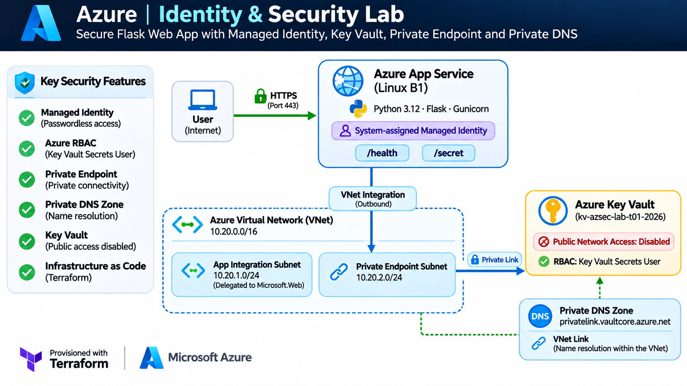

# Azure Identity & Security Lab

[](https://azure.microsoft.com/)
[](https://www.terraform.io/)
[](https://www.python.org/)
[](https://flask.palletsprojects.com/)
[](https://learn.microsoft.com/azure/key-vault/)

**Secure application-to-service authentication in Microsoft Azure using Managed Identity, Azure RBAC, Private Endpoint and Private DNS.**

---

## 📐 Architecture

<p align="center">
  
</p>

## 🎯 Project Overview

This project demonstrates how to deploy a Python Flask application on Azure App Service and securely retrieve secrets from Azure Key Vault without storing credentials in application code.

Infrastructure is provisioned using **Terraform**, while Azure-native identity, authorization and networking services protect access to sensitive information.

The App Service exposes an HTTPS application endpoint, while Key Vault is configured with public network access disabled and accessed through a Private Endpoint.

## 🏗️ Architecture Components

| Component | Configuration / Purpose |
|---|---|
| ☁️ Azure App Service | Linux B1 · Python 3.12 · Flask · Gunicorn |
| 🔐 Managed Identity | System-assigned identity |
| 🗝️ Azure Key Vault | Public network access disabled |
| 🛡️ Azure RBAC | Key Vault Secrets User |
| 🌐 Virtual Network | `10.20.0.0/16` |
| 🔗 App Service Integration Subnet | `10.20.1.0/24` |
| 🔒 Private Endpoint Subnet | `10.20.2.0/24` |
| 🔐 Private Endpoint | Private connectivity to Key Vault |
| 📡 Private DNS Zone | `privatelink.vaultcore.azure.net` |
| ⚙️ Terraform | Infrastructure as Code |

## 🔒 Security Implementation

| Security control | Implementation |
|---|---|
| Authentication | System-assigned Managed Identity |
| Authorization | Azure RBAC — Key Vault Secrets User |
| Network access | Private Endpoint and Private Link |
| Key Vault exposure | Public network access disabled |
| DNS resolution | Private DNS Zone with VNet link |
| Application transport | HTTPS |
| Secret protection | Secret value is never returned by the API |

## 🐍 Flask Application

The application exposes two HTTP endpoints:

| Endpoint | Method | Description |
|---|---|---|
| `/health` | GET | Application health check |
| `/secret` | GET | Retrieves a secret from Azure Key Vault |

The `/secret` endpoint reports the retrieval status without exposing the actual secret value.

## 📚 Project Documentation

Additional technical documentation is available:

- [Architecture Design](docs/architecture.md)
- [Security Design](docs/security-design.md)
- [Cost Analysis](docs/cost-analysis.md)

## 📂 Repository Structure

```text
azure-identity-security-lab/
├── app/
│   ├── app.py
│   ├── requirements.txt
│   └── README.md
├── docs/
│   ├── architecture/
│   │   └── azure-identity-security-architecture.png
│   ├── architecture.md
│   ├── cost-analysis.md
│   └── security-design.md
├── terraform/
│   └── environments/
│       └── dev/
│           ├── app_service.tf
│           ├── keyvault.tf
│           ├── main.tf
│           ├── networking.tf
│           ├── outputs.tf
│           ├── private_dns.tf
│           ├── private_endpoint.tf
│           ├── provider.tf
│           ├── rbac.tf
│           ├── terraform.tfstate* (local only, not committed)
│           ├── variables.tf
│           ├── versions.tf
│           └── .terraform.lock.hcl
├── .gitignore
└── README.md
```

## 🚀 Deployment

### Prerequisites

- Microsoft Azure subscription
- Azure CLI
- Terraform >= 1.9.0
- Python 3.12
- Git

### 1. Azure Authentication

```bash
az login
az account set --subscription "<SUBSCRIPTION_ID>"
az account show
```

Configure the subscription ID as a Terraform environment variable:

```bash
export TF_VAR_subscription_id="$(az account show --query id -o tsv)"
```

### 2. Initialize Terraform

```bash
cd terraform/environments/dev

terraform init
```

### 3. Validate Terraform Configuration

```bash
terraform validate
```

### 4. Review Infrastructure Changes

```bash
terraform plan
```

Review the planned resources, configuration and potential costs before deployment.

### 5. Deploy Infrastructure

```bash
terraform apply
```

### 6. Review Deployment Outputs

```bash
terraform output
```

## 🧪 Validation

The following checks define the project's validation scope. They must be verified against a fresh deployment before being marked as completed.

- [ ] App Service deployment and HTTPS endpoint.
- [ ] Flask application health endpoint.
- [ ] System-assigned Managed Identity.
- [ ] Azure RBAC permissions.
- [ ] Key Vault secret retrieval.
- [ ] Private Endpoint connectivity.
- [ ] Private DNS resolution.
- [ ] Key Vault public network access disabled.

## 📸 Evidence

Execution screenshots and Azure resource validation evidence will be added after the next deployment and verification cycle.

Evidence will cover Terraform execution, application health, Managed Identity, RBAC permissions, private connectivity, secret retrieval and resource cleanup.

## 💰 Cost Management

Azure resources in this lab may generate charges while deployed.

| Resource | Cost consideration |
|---|---|
| App Service Plan B1 | Recurring compute plan charges |
| Private Endpoint | Hourly and data processing charges |
| Key Vault | Operations and transactions |
| Private DNS Zone | Zone and DNS query charges |
| Virtual Network | No base charge; associated services may incur costs |

**Cost control strategy:**

- Review regional Azure pricing before deployment.
- Use `terraform plan` to inspect resources before applying changes.
- Keep the environment deployed only while performing tests.
- Destroy resources when the lab is no longer required.
- Verify resource cleanup in the Azure Portal.

To remove the deployed infrastructure:

```bash
terraform destroy
```

**Important:** Key Vault soft-delete retention may preserve a deleted vault temporarily. Its deletion lifecycle should be considered when verifying cleanup.

For detailed cost considerations, see [Cost Analysis](docs/cost-analysis.md).

## 🧰 Technologies

- Microsoft Azure
- Terraform
- Azure App Service
- Azure Key Vault
- Managed Identity
- Azure RBAC
- Azure Private Link
- Private DNS
- Python / Flask
- Git

---

## 👨‍💻 Author

**Teodoro Diaz**

Cloud Infrastructure | Azure | Terraform | DevOps

[GitHub Profile](https://github.com/teodoro-diaz) | [LinkedIn](https://www.linkedin.com/in/teodorodiazcha/)